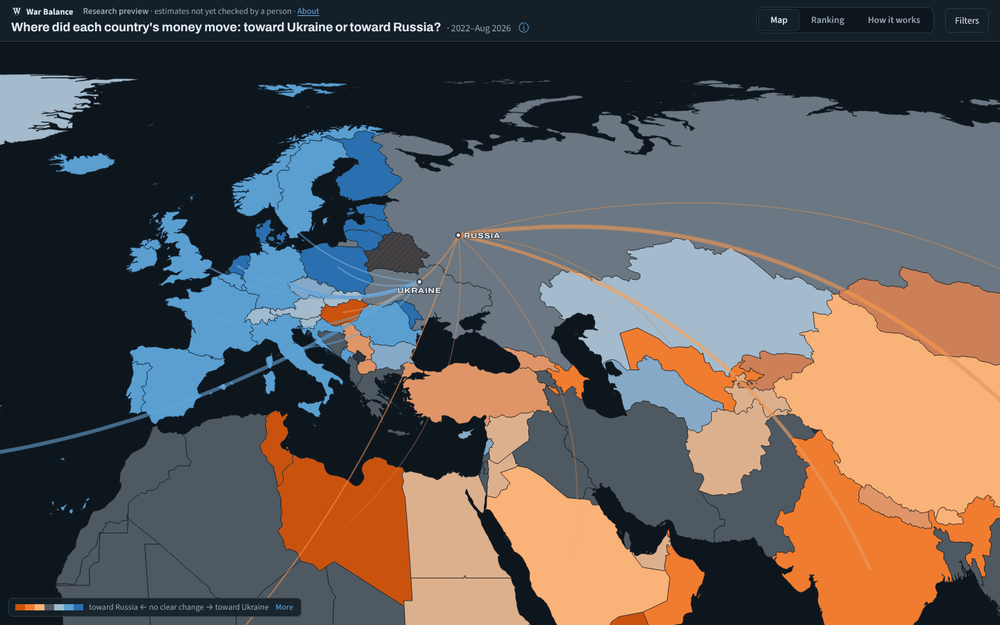

# War Balance

War Balance has no connection to Follow the Money (ftm.nl / ftm.eu). During its first week the project was called “Follow the Money: Ukraine”; that name remains on early commits.

An interactive map: did each country's money move toward Ukraine or toward Russia since 2022, against a world without
the war? Every number has its sources, a range and a certainty letter.

Cite the data as: War Balance, https://warbalance.org/, [doi:10.5281/zenodo.23832992](https://doi.org/10.5281/zenodo.23832992) (all versions on Zenodo).

**Website: https://warbalance.org/** · Research preview: check the sources before quoting a figure
([limitations](https://warbalance.org/#view=how&sec=limitations)).



## Documentation

Everything a reader needs is on the website, under **How it works**, written once and kept there:

- [How it works](https://warbalance.org/#view=how): how to trace a number, the
  method, every money flow with its sources, and [the method in full](https://warbalance.org/#view=how&sec=method-full)
- [Limitations](https://warbalance.org/#view=how&sec=limitations)
- [Changelog](https://warbalance.org/#view=how&sec=changelog): every update in short; the full record of every
  decision is in [`docs/changelog-full.md`](docs/changelog-full.md)
- [Download the data](https://warbalance.org/#view=how&sec=data): CSV and JSON

The text behind those pages is in [`site/content/`](site/content/) (Markdown, rendered by the site); edit it there.
Developer detail behind each method page is in [`docs/reference/method/`](docs/reference/method/).

## Repository

| Folder | What it holds |
|---|---|
| `site/` | the website: `index.html`, `views.js`, `views2.js`, `i18n/`, the data (`data.json`, `detail.json`) and `content/` (How it works) |
| `pipeline/` | `build_data.py` turns the research files into `site/data.json` and `site/detail.json`; `check_data.py` runs the 44 checks; `tests/` holds the unit tests |
| `research/2026-10/` | every input (JSON) with a notes file beside it: sources, retrieval dates and the reasoning behind each estimate |
| `docs/reference/` | developer notes: [the pipeline](docs/reference/pipeline.md), [the research files](docs/reference/research-files.md), [the site](docs/reference/site.md), and [each method page in full technical detail](docs/reference/method/) |

Run it yourself:

```sh
./setup.sh                                  # dependencies and pre-commit hooks
cd pipeline && uv run build_data.py         # rebuild site/data.json and site/detail.json from research/ (~30 s)
uv run check_data.py                        # the 44 checks (node and Playwright for the browser checks)
uv run pytest -q                            # unit tests (pipeline/tests/)
cd ../site && python3 -m http.server 8000   # open http://localhost:8000
```

CI (`.github/workflows/checks.yml`) runs the build, the checks and the tests on every push and before every deploy; commit
the rebuilt `data.json` and `detail.json` with any change to the research files or the pipeline
([details](docs/reference/pipeline.md)).

## Corrections

Found a wrong number, a better source or a missing flow? Open an issue with the country, the figure and a link to the
source, or send a message to [u/Intelligent-Cream-14 on Reddit](https://www.reddit.com/user/Intelligent-Cream-14/).

## Licence

- Code: MIT, see [`LICENSE`](LICENSE).
- Data and text (`site/data.json`, `site/content/`, `research/`): CC BY 4.0, see [`LICENSE-DATA.md`](LICENSE-DATA.md).
  The original sources keep their own terms; see the source list in each research file.
- Country shapes: [world-atlas](https://github.com/topojson/world-atlas) (ISC licence), from Natural Earth (public domain).
